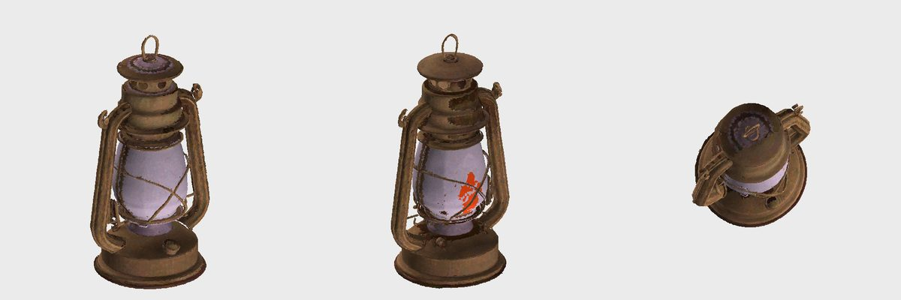

# PS5MG - 3D Mesh Generation on PS5

**Picture to textured 3D mesh, on the PlayStation 5.** Drop a picture in the web interface, get a game-ready GLB
(150k faces, 1024 px texture) in one to three minutes, made entirely on the console's own GPU.

PS5MG is the third title in the line of [PS5LM](https://github.com/cobanov/PS5LM) (language models) and
[PS5SD](https://github.com/Darkatek7/PS5SD) (Stable Diffusion): same toolchain, same screen, same install.
Title id `PPSA99577`.

| on the TV while it works | when it is done |
|---|---|
|  |  |

## What you get

- **Web interface** on port 7870: upload a picture, choose model, weights, resolution, texture, steps; a queue with live
  stage and progress; finished meshes in a 3D viewer (three.js from a CDN, so the browser needs internet) and the GLB download.
- **A REST API** for scripts ([docs/API.md](docs/API.md)).
- **The PS5 screen:** PS5SD's dashboard (state, QR code of the web address, running job with its picture, time left,
  memory, log).
- **Two model families:** [TRELLIS.2](https://github.com/microsoft/TRELLIS.2) (textured meshes, the default) and
  [Pixal3D](https://huggingface.co/vegax87/Pixal3D) (a pixel-aligned TRELLIS.2 fine-tune, closer to the picture, geometry only at 512).
- A job queue on disk, so the console can be driven by files over FTP too (`tools/mg.sh`, `tools/run-queue.sh`).

## How fast

Textured mesh, TRELLIS.2 q4, resolution 512, 8 steps, 150k faces, 1024 px texture, measured on a console:

| object | PS5 | PC (RX 7800 XT, trellis.cpp as it comes) |
|---|---|---|
| lantern | 1:53 | 5:42 |
| sword | 1:08 | about 3:00, no texture |
| shield | 1:51 | 5:39 |
| potion | 2:22 | 7:04 |
| blaster | 1:27 | 4:28 |

The first run on the console, with trellis.cpp as it is, took 19:51 and had no texture. What made the difference:

| change | why | effect |
|---|---|---|
| `ps5/deform_conv_fast.cpp` | BiRefNet's deformable convolution sampled the picture once per output channel on the CPU | 50x faster, same output (`tools/test-deform`) |
| `ps5/decimate_qem_fast.cpp` | the QEM simplifier was single threaded around one big hash map | 10x faster, same result on the test mesh (`tools/test-decimate`) |
| `ps5/birefnet_interp.inc` | the decoder's last upscale (192 channels to 1024 x 1024) walked the channels per pixel on one thread | 25 s to about 1 s |
| `read()` instead of `fread` | the console's stdio reads 92 MB/s whatever the buffer, `read()` does 1 to 2 GB/s | loading the weights: 56 s to 4 s |
| `ps5/ps5mg_threads.h` | `hardware_concurrency()` says 16, a title may use the CPUs of its affinity mask (minus two) | no oversubscription |
| no PLY next to the GLB | doubled the file writes | seconds |
| Pixal3D orientation | its meshes are y-up already, the GLB writer turned them again | upright GLB |
| a fresh process per job | a second job in the same process ran 4 to 9 times slower, GPU stages included | the title restarts itself after every job |

All of it is applied at build time (`scripts/build-mg.sh`); trellis.cpp is cloned at a pinned commit and left as it is.
More numbers and the variant study (steps, q8, atlas size, face budget, seeds, Pixal3D at 1024) are in
[docs/RESULTS.md](docs/RESULTS.md).

## Quick start

1. **Build:** every push builds the title in GitHub Actions. Fork, push, download the artifact
   (`gh run download <id> -n ps5mg-title`), or build with Docker: [docs/BUILDING.md](docs/BUILDING.md).
2. **Install** on a jailbroken console: copy `PPSA99577/` to `/data/homebrew/` over FTP and rescan in ShadowMountPlus.
3. **Weights:** `tools/get-weights.sh` (about 6.5 GB, q4) on a PC, then `PS5_HOST=<console> tools/put-weights.sh`.
   Optional: `tools/get-more-weights.sh` for q8 and Pixal3D.
4. Start the title and open `http://<console>:7870`.

Picture rules for good meshes: one object, three-quarter view, plain light background, no stand, no shadow.
Glass and flames get lost in the mesh; that is the model, not the console.

## Known problems

- A second job in the same process is much slower, so the title restarts itself after each job. The cause is not found
  (leftover worker threads are the guess). A long soak test of the self-restart is still to do.
- Pixal3D at 1024 with texture ran for one picture and stopped without an error on two others (probably memory).
- One job (a chest, seed 5) took twice as long as its peers, unexplained.
- The web interface has no authentication yet: use it on a trusted network only.
- During one night's run the CPU stages turned 2.5 times slower for hours and the console later refused to start
  titles; a reboot of the console cured both. Whether the self-restart plays a part is not known.

See [ROADMAP.md](ROADMAP.md) for what is next.

## Credits

This is a port and a glue project; the hard work is other people's.

- **[TRELLIS.2](https://github.com/microsoft/TRELLIS.2)** by Microsoft Research: the image-to-3D model.
- **[trellis.cpp](https://github.com/pwilkin/trellis.cpp) and [ggml (pwilkin's fork)](https://github.com/pwilkin/ggml)**
  by Piotr Wilkin: the C++ port of TRELLIS.2 this title is built from. [ilintar/trellis2-gguf](https://huggingface.co/ilintar/trellis2-gguf)
  has the GGUF weights.
- **[Z-Image Turbo](https://github.com/Tongyi-MAI/Z-Image)** (Tongyi-MAI, Apache-2.0), run on the console with PS5SD: it drew the example pictures in this README, so even the inputs were made on a PS5.
- **[Pixal3D](https://huggingface.co/vegax87/Pixal3D)**: vegax87's GGUF of the pixel-aligned TRELLIS.2 fine-tune.
- **[BiRefNet](https://github.com/ZhengPeng7/BiRefNet)** (background removal) and **DINOv3** by Meta (image features),
  both part of the TRELLIS.2 pipeline.
- **[PS5SD](https://github.com/Darkatek7/PS5SD)** (Darkatek7 and contributors): the build recipe, the screen and the install
  layout; it is a submodule here. PS5SD follows **[PS5LM](https://github.com/cobanov/PS5LM)** by cobanov.
- **[PS5_Vulkan](https://github.com/mihawk-99/PS5_Vulkan)**, PS5_Mesa and PS5_PayloadSDK by mihawk-99: Vulkan on the console
  (RADV) and the toolchain. **[ps5-homebrew-ui](https://github.com/Phononenom/ps5-homebrew-ui)** for the dashboard,
  **[ps5-homebrew-dev-protocol](https://github.com/manoma080/ps5-homebrew-dev-protocol)** for the launch payload,
  **[ftpsrv](https://github.com/drakmor/ftpsrv)** by drakmor, and ShadowMountPlus and elfldr for running titles.
- **[cpp-httplib](https://github.com/yhirose/cpp-httplib)** (web server, shipped with trellis.cpp) and
  **[three.js](https://threejs.org)** (viewer, loaded from a CDN).

PS5MG is an independent hobby project. It is not affiliated with, authorised or endorsed by Sony Interactive Entertainment,
Microsoft, Meta or any of the projects above. "PlayStation" and "PS5" are trademarks of Sony Interactive Entertainment.

## Licences, plainly

Not legal advice. Read the originals if money is involved.

| part | licence |
|---|---|
| **PS5MG as built (the title)** | **GPL-3.0** (see `LICENSE`): the screen and build code come from PS5SD and PS5LM, which are GPL-3.0 |
| PS5MG's own sources (`ps5/`, `scripts/`, `tools/`) | GPL-3.0, as part of this repository |
| trellis.cpp, ggml, cpp-httplib | MIT |
| TRELLIS.2 (code and weights) | MIT (Microsoft) |
| Pixal3D weights | MIT, as stated on its Hugging Face page |
| BiRefNet | MIT |
| **DINOv3** (inside every TRELLIS.2 GGUF set as `dinov3.gguf`) | **Meta's own DINOv3 License**, not MIT: [text](https://ai.meta.com/resources/models-and-libraries/dinov3-license). Use is allowed under its terms (no export-controlled or military uses; pass the licence on if you redistribute; and more). Read it before you build a product on it. |
| the GGUF conversion ([ilintar/trellis2-gguf](https://huggingface.co/ilintar/trellis2-gguf)) | its card says only "other, see the source model" |
| PS5_Vulkan, ps5-homebrew-ui, ftpsrv and the rest | each under its own licence: see their repositories |

**What this repository does not contain:** no model weights, no Meta or Microsoft files, no PlayStation SDK or firmware,
no game code. You download the weights yourself (`tools/get-weights.sh`) from their original sources, under their licences.
The title is built from source in CI or in Docker with open-source homebrew toolchains.

**Your meshes:** TRELLIS.2 is MIT-licensed and PS5MG adds no restriction on what comes out. What you make comes from your
pictures, so you need the rights to the pictures you put in. If you sell what you make, check the DINOv3 licence above.

**Running homebrew** needs a jailbroken console, which is your own choice and risk and may conflict with the terms of your
console's firmware licence. This project neither ships nor asks for an exploit.
