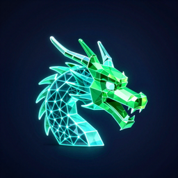
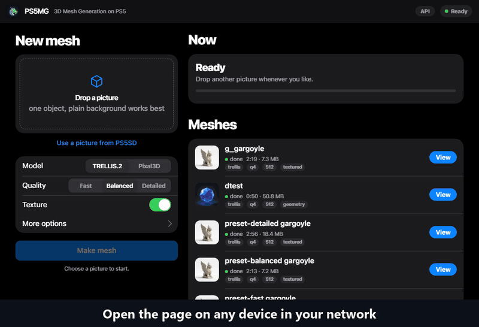
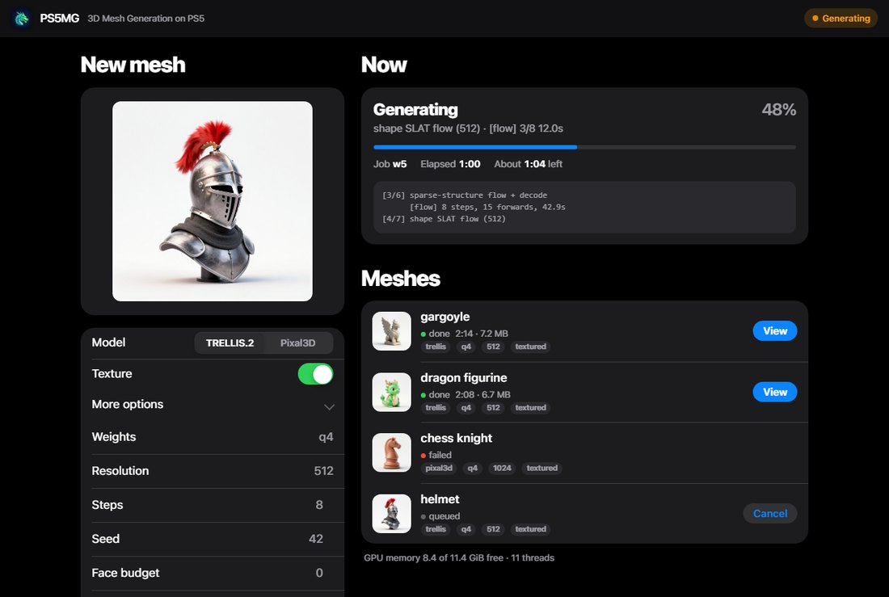
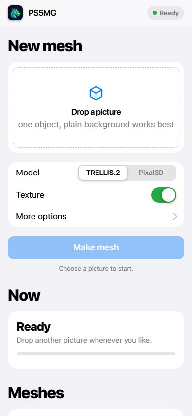
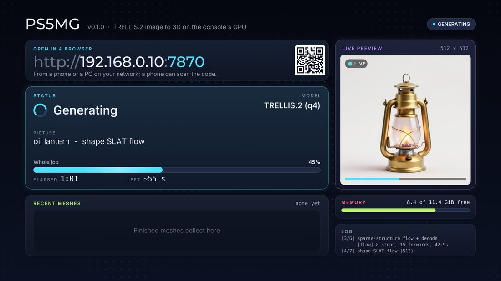
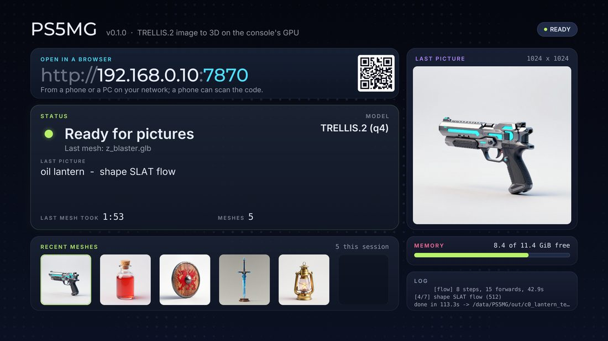
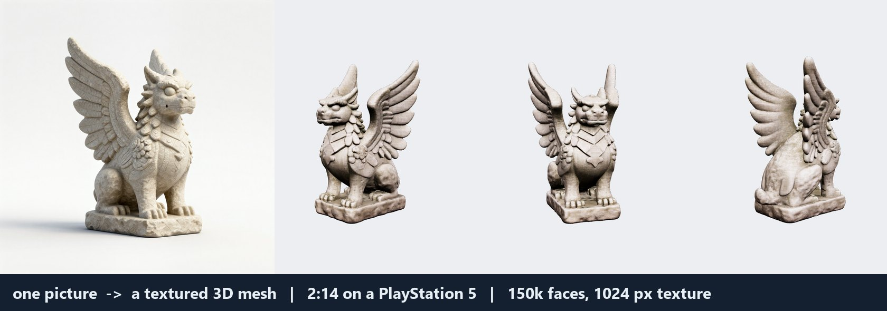
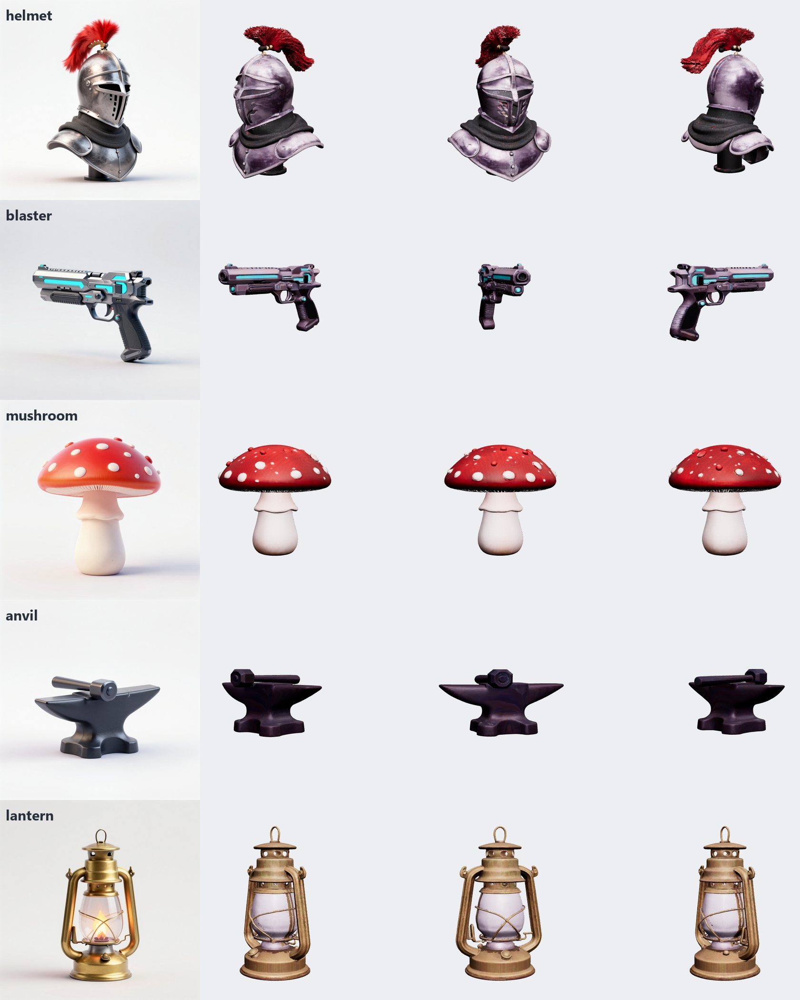
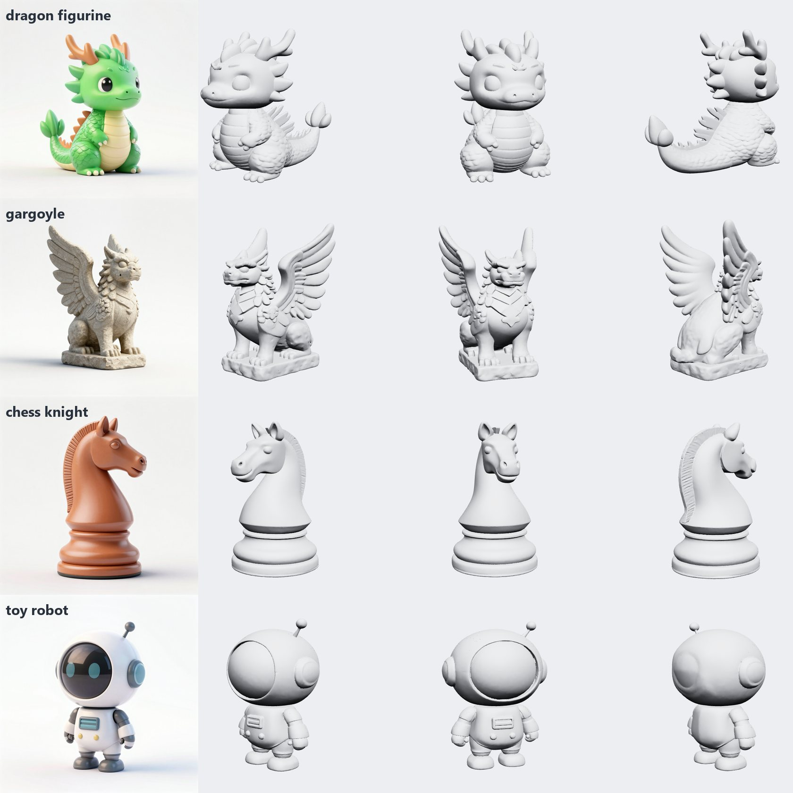
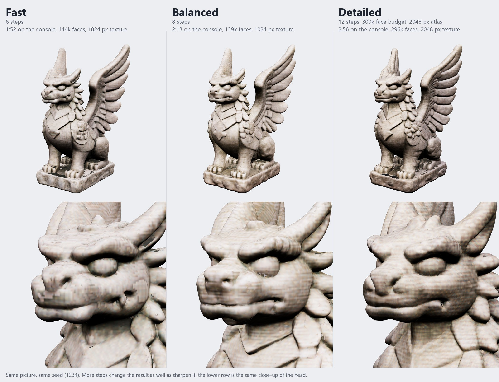

<p align="center"></p>

# PS5MG - 3D Mesh Generation on PS5

<p align="center">
  <b>Your PS5 turns a picture into a textured 3D mesh, on its own GPU.</b><br>
  TRELLIS.2 with a web interface and a TV dashboard. Game assets and figurines from one picture.
</p>

<p align="center">
  <b><a href="https://github.com/nikay99/PS5MG/releases/latest">Get the app</a></b> |
  <a href="https://nikay99.github.io/PS5MG/">Gallery</a> |
  <a href="#quick-start">Quick start</a> |
  <a href="https://github.com/nikay99/PS5MG/issues">Issues</a>
</p>

> **Legal notice, short.** PS5MG contains no model weights and downloads nothing: the title has no network client, only a web
> server for your own network. You fetch the weights yourself from their authors, after accepting their licences
> (`tools/get-weights.sh` asks first). PS5MG is not affiliated with Sony, Microsoft or Meta, ships no exploit and asks for none.
> Details: [Licences, plainly](#licences-plainly) and [THIRD_PARTY_NOTICES.md](THIRD_PARTY_NOTICES.md).

<p align="center">
  <a href="docs/media/demo.mp4"></a><br>
  <sub>A real run on a PS5. The wait is sped up (the job took 2:19 here). Click for the video.</sub>
</p>

Drop a picture in the web interface and get a game-ready GLB (150k faces, 1024 px texture) in one to three minutes, made
entirely on the console's own GPU.

PS5MG is the third title in the line of [PS5LM](https://github.com/cobanov/PS5LM) (language models) and
[PS5SD](https://github.com/Darkatek7/PS5SD) (Stable Diffusion): same toolchain, same screen, same install.
Title id `PPSA99577`.

## Who is it for

- 3D-printing hobbyists who want a figurine from a picture.
- Game developers and jam participants who need quick assets (GLB opens in Blender, Godot, Unity and Unreal).
- Tinkerers who like that all of this runs on a game console.

## Why it is fun

- A mesh in about one to three minutes on the console (1:08 to 2:22 for the five objects in [How fast](#how-fast)).
- No PC needed while it runs: the console does the work, any browser on your network is the remote.
- Meshes without holes, with a texture or as plain geometry. For printing, let your slicer's repair check them (see Examples).
- STL and OBJ downloads for printing (the mesh stands on the plate, scaled to the size you give), quality presets, several
  pictures at once, and a picker for the pictures PS5SD made on the same console.

| web interface (desktop) | on a phone |
|---|---|
|  |  |

*The interface is a single page the title serves itself; the pictures show it with sample data.*

| on the TV while it works | when it is done |
|---|---|
|  |  |

## What you get

- **Web interface** on port 7870: drop one picture or several, or pick one PS5SD made; choose a quality preset (or the model, weights,
  resolution, texture, steps and more under More options); a queue with live stage and progress; finished meshes in a 3D viewer
  (three.js from a CDN, so the browser needs internet) with GLB, STL and OBJ downloads.
- **A REST API** for scripts: the page's **API** button shows ready-made `curl` calls for your console (with a copy button and a
  hint whether it is protected by a key); see [Use it from a script](#use-it-from-a-script) and [docs/API.md](docs/API.md).
- **The PS5 screen:** PS5SD's dashboard (state, QR code of the web address, running job with its picture, time left,
  memory, log).
- **Two model families:** [TRELLIS.2](https://github.com/microsoft/TRELLIS.2) (textured meshes, the default) and
  [Pixal3D](https://huggingface.co/vegax87/Pixal3D) (a pixel-aligned TRELLIS.2 fine-tune, closer to the picture, geometry only at 512).
- A job queue on disk, so the console can be driven by files over FTP too (`tools/mg.sh`, `tools/run-queue.sh`).



## Quick start

**You need:** a console that can run homebrew titles (ShadowMountPlus) with an FTP server on port 2121, a PC (Windows, macOS or
Linux) on the same network, and about 7 GB free on the console. Which exploit and firmware you need is outside this project, as with
PS5SD and PS5LM.

### 1. Install PS5MG

- **From the PS5 Homebrew Store** (ProsperoStore, [prosperostore.net](https://prosperostore.net)): search for PS5MG.
- **Or by hand:** download `PPSA99577.zip` from the [latest release](https://github.com/nikay99/PS5MG/releases/latest), unzip it, copy the
  folder `PPSA99577` to `/data/homebrew` on the console with any FTP client (port 2121), then rescan in ShadowMountPlus.
  (Or build it yourself: [docs/BUILDING.md](docs/BUILDING.md).)

### 2. Put the model files on the console (one command)

PS5MG does not include the model files (about 6.5 GB). One command on your PC downloads them from their authors, checks them and copies
them to the console. First get the PS5MG tools: **[Download ZIP](https://github.com/nikay99/PS5MG/archive/refs/heads/main.zip)** and unzip it
(or `git clone` this repository). Then, in that folder, use your console's address in place of `192.168.1.50`:

**Windows**: double-click `tools\setup-weights.bat` (it asks for the address), or in a terminal:

```powershell
powershell -ExecutionPolicy Bypass -File .\tools\setup-weights.ps1 192.168.1.50
```

**macOS / Linux** (also WSL and Git Bash):

```sh
./tools/setup-weights.sh 192.168.1.50
```

It shows the licences of the models and asks you to type `yes`; then it downloads, checks every file and copies it to
`/data/PS5MG/models/q4/` on the console. If it stops (Wi-Fi, sleep), run it again: it continues where it was and skips what is already there.
Options: `--no-birefnet` leaves out the 883 MB cut-out model (optional, a simple cut-out is used instead), `--pixal3d` adds the Pixal3D files,
`--set q8` uses the larger q8 set. The PowerShell version takes `-NoBirefnet`, `-Pixal3d` and `-Set q8`.

### 3. Make your first mesh

Start PS5MG from its icon, open `http://<console>:7870` in a browser, drop a picture. A textured mesh is ready in one to three minutes.
The page tells you if a model file is still missing, and which one.

### If something does not work

- **The title is not on the home screen:** rescan in ShadowMountPlus, and check that `PPSA99577/` is directly inside `/data/homebrew`.
- **The page does not open:** check that the title is running and that you use port 7870 and the console's address.
- **The page says model files are missing:** run the command of step 2 again; "Check again" on the page updates the list.
- **The command cannot reach the console:** is the FTP server on the console running, on port 2121, and is the address right?
- **A job failed:** click "Why?" in the page; it shows the log lines. `PS5_HOST=<console> tools/mg.sh log` prints the whole log.

Picture rules for good meshes: one object, three-quarter view, plain light background, no stand, no shadow.
Glass and flames get lost in the mesh; that is the model, not the console.

## Examples

**[Turn them around in the gallery](https://nikay99.github.io/PS5MG/)**: ten of these, as meshes you can rotate in the browser.

Every picture below was drawn on the console too: PS5SD running Z-Image Turbo (about 85 s each), then PS5MG (1:44 to 4:04 per
mesh, 150k faces, 1024 px texture). The renders are the GLB files as they come out, lit in three.js (`tools/render-glb.py`).

### Game assets

Textured GLB files (a 1024 px colour texture on a box-projected UV layout); open them in Blender, Godot, Unity or Unreal.



### 3D printing and figurines

The same meshes without their texture, as grey clay: this is the geometry you would slice. I checked the meshes only on the
computer, not on a printer: they are closed surfaces (no open edges) but a few edges are non-manifold (38 on the dragon, up to
a few thousand on others), so let the slicer's repair (PrusaSlicer, Bambu Studio) or Meshmixer fix them, and look at thin parts
before you print. The textures are not needed for printing.



### Quality presets

The page has three presets. This is one picture (the gargoyle) made with each, same seed, on the console:



| preset | steps | faces | texture | time |
|---|---|---|---|---|
| Fast | 6 | 144k | 1024 px | 1:52 |
| Balanced | 8 | 139k | 1024 px | 2:13 |
| Detailed | 12 (face budget 300k, atlas 2048) | 296k | 2048 px | 2:56 |

In the close-up, Fast shows blocky patches in the texture around the nose and mouth; Detailed has a crisper texture and cleaner
edges. More steps change the shape a little as well, they do not only sharpen it. A Detailed GLB is bigger (18 MB here, 7 MB for the others).

## Use it from a script

Everything the page does is an HTTP call, so scripts, a phone shortcut or a batch loop can make meshes too. The page's **API** button
shows ready-made calls for your console. The settings are form fields of `POST /api/jobs`: `family`, `weights`, `res`, `texture`,
`seed`, `steps`, `faces`, `atlas`, `uv` and `label`. Send them with `curl -F` or `curl -d`, or in the query string.

```sh
# a detailed mesh, another seed, no texture
curl -F image=@picture.png -F steps=12 -F faces=300000 -F atlas=2048 -F seed=7 -F texture=off http://<console>:7870/api/jobs
# {"id":"w20261022-141752-0"}

curl http://<console>:7870/api/jobs                                       # the queue: status, seconds, size
curl -o mesh.glb http://<console>:7870/api/jobs/w20261022-141752-0/glb   # the finished mesh

# a picture PS5SD made on the same console
curl -d from_ps5sd=sd_20261022_101919_003.png -d steps=6 http://<console>:7870/api/jobs
```

A number out of range is clamped, a wrong choice is answered with `400` and the reason. If the console is protected with a key
(`tools/mg.sh setkey <key>`), add `-H "Authorization: Bearer <key>"`. All fields, values and defaults: [docs/API.md](docs/API.md).

## How fast

Textured mesh, TRELLIS.2 q4, resolution 512, 8 steps, 150k faces, 1024 px texture, measured on a console:

| object | PS5 | PC (RX 7800 XT, trellis.cpp as it comes) |
|---|---|---|
| lantern | 1:53 | 5:42 |
| sword | 1:08 | about 3:00, no texture |
| shield | 1:51 | 5:39 |
| potion | 2:22 | 7:04 |
| blaster | 1:27 | 4:28 |

The first run on the console, with trellis.cpp as it is, took 19:51 and had no texture. What made the difference:

| change | why | effect |
|---|---|---|
| `ps5/deform_conv_fast.cpp` | BiRefNet's deformable convolution sampled the picture once per output channel on the CPU | 50x faster, same output (`tools/test-deform`) |
| `ps5/decimate_qem_fast.cpp` | the QEM simplifier was single threaded around one big hash map | 10x faster, same result on the test mesh (`tools/test-decimate`) |
| `ps5/birefnet_interp.inc` | the decoder's last upscale (192 channels to 1024 x 1024) walked the channels per pixel on one thread | 25 s to about 1 s |
| `read()` instead of `fread` | the console's stdio reads 92 MB/s whatever the buffer, `read()` does 1 to 2 GB/s | loading the weights: 56 s to 4 s |
| `ps5/ps5mg_threads.h` | `hardware_concurrency()` says 16, a title may use the CPUs of its affinity mask (minus two) | no oversubscription |
| no PLY next to the GLB | doubled the file writes | seconds |
| Pixal3D orientation | its meshes are y-up already, the GLB writer turned them again | upright GLB |
| a fresh process per job | a second job in the same process ran 4 to 9 times slower, GPU stages included | the title restarts itself after every job |

All of it is applied at build time (`scripts/build-mg.sh`); trellis.cpp is cloned at a pinned commit and left as it is.
More numbers and the variant study (steps, q8, atlas size, face budget, seeds, Pixal3D at 1024) are in
[docs/RESULTS.md](docs/RESULTS.md).

## Where the weights come from

PS5MG has no model weights of its own and never downloads any: the command above (or you, by hand) gets them from their authors, once.
This is what it fetches, from [ilintar/trellis2-gguf](https://huggingface.co/ilintar/trellis2-gguf) (TRELLIS.2 as GGUF, folder `q4`, a fixed
revision). **Each name is a direct download link** if you prefer your browser:

| File | Size | What it is for |
|---|---|---|
| [`birefnet.gguf`](https://huggingface.co/ilintar/trellis2-gguf/resolve/a57397bd3d351599d9729fc144b3f87c3f87d65b/q4/birefnet.gguf) | 883 MB | cuts the object out of the picture (**optional**: without it a simple cut-out is used) |
| [`dinov3.gguf`](https://huggingface.co/ilintar/trellis2-gguf/resolve/a57397bd3d351599d9729fc144b3f87c3f87d65b/q4/dinov3.gguf) | 173 MB | image encoder (DINOv3, by Meta): turns the picture into features |
| [`shape_dec.gguf`](https://huggingface.co/ilintar/trellis2-gguf/resolve/a57397bd3d351599d9729fc144b3f87c3f87d65b/q4/shape_dec.gguf) | 845 MB | the shape |
| [`shape_flow_1024.gguf`](https://huggingface.co/ilintar/trellis2-gguf/resolve/a57397bd3d351599d9729fc144b3f87c3f87d65b/q4/shape_flow_1024.gguf) | 731 MB | only for resolution 1024 |
| [`shape_flow_512.gguf`](https://huggingface.co/ilintar/trellis2-gguf/resolve/a57397bd3d351599d9729fc144b3f87c3f87d65b/q4/shape_flow_512.gguf) | 731 MB | the shape |
| [`ss_dec.gguf`](https://huggingface.co/ilintar/trellis2-gguf/resolve/a57397bd3d351599d9729fc144b3f87c3f87d65b/q4/ss_dec.gguf) | 147 MB | rough 3D structure |
| [`ss_flow.gguf`](https://huggingface.co/ilintar/trellis2-gguf/resolve/a57397bd3d351599d9729fc144b3f87c3f87d65b/q4/ss_flow.gguf) | 730 MB | rough 3D structure |
| [`tex_dec.gguf`](https://huggingface.co/ilintar/trellis2-gguf/resolve/a57397bd3d351599d9729fc144b3f87c3f87d65b/q4/tex_dec.gguf) | 845 MB | colours and material |
| [`tex_flow_1024.gguf`](https://huggingface.co/ilintar/trellis2-gguf/resolve/a57397bd3d351599d9729fc144b3f87c3f87d65b/q4/tex_flow_1024.gguf) | 731 MB | only for resolution 1024 |
| [`tex_flow_512.gguf`](https://huggingface.co/ilintar/trellis2-gguf/resolve/a57397bd3d351599d9729fc144b3f87c3f87d65b/q4/tex_flow_512.gguf) | 731 MB | colours and material |

Copy them with any FTP client to `/data/PS5MG/models/q4/` on the console. The exact revision and the SHA-256 of every file are in
[tools/weights.sha256](tools/weights.sha256).

<details>
<summary>More: the q8 set, Pixal3D, and the licences</summary>

**q8** is the same set at higher precision (about twice as big), in the folder `q8` of the same page; copy it to `/data/PS5MG/models/q8/`.

**Pixal3D** ([vegax87/Pixal3D](https://huggingface.co/vegax87/Pixal3D)) is an optional second model. Its five files go into the **same folder**
as your TRELLIS set, because they share `dinov3.gguf`:

| File | Size |
|---|---|
| [`pixal3d_naf.gguf`](https://huggingface.co/vegax87/Pixal3D/resolve/51de7d1764f4b735c4e3aaea40e5ba60c18ca707/pixal3d_naf.gguf) | 1 MB |
| [`pixal3d_shape_flow_1024.gguf`](https://huggingface.co/vegax87/Pixal3D/resolve/51de7d1764f4b735c4e3aaea40e5ba60c18ca707/pixal3d_shape_flow_1024.gguf) | 2776 MB |
| [`pixal3d_shape_flow_512.gguf`](https://huggingface.co/vegax87/Pixal3D/resolve/51de7d1764f4b735c4e3aaea40e5ba60c18ca707/pixal3d_shape_flow_512.gguf) | 2776 MB |
| [`pixal3d_ss_flow.gguf`](https://huggingface.co/vegax87/Pixal3D/resolve/51de7d1764f4b735c4e3aaea40e5ba60c18ca707/pixal3d_ss_flow.gguf) | 2682 MB |
| [`pixal3d_tex_flow_1024.gguf`](https://huggingface.co/vegax87/Pixal3D/resolve/51de7d1764f4b735c4e3aaea40e5ba60c18ca707/pixal3d_tex_flow_1024.gguf) | 2776 MB |

**Licences, in short:** TRELLIS.2 and Pixal3D are MIT (use, copy and share them, keep the licence text). BiRefNet is MIT.
**DINOv3 is under Meta's own licence**, which also allows use but with its own terms: read it
([text](https://ai.meta.com/resources/models-and-libraries/dinov3-license)), especially before you sell anything you make.
The GGUF conversions are by their authors on Hugging Face. Details: [Licences, plainly](#licences-plainly).

</details>

## Known problems

- A second job in the same process is much slower, so the title restarts itself after each job. The cause is not found
  (leftover worker threads are the guess).
- **The console gets slower after many jobs in a row.** In a test of 37 short jobs one after the other, every job finished and the restart
  after each one worked, but from job 17 on a job took about 2.6 times as long, and it did not recover. The cause is not found (heat,
  the system's memory or the restarts); the numbers are in [docs/RESULTS.md](docs/RESULTS.md). A restart of the console cured the same effect once.
- Pixal3D at 1024 with texture ran for one picture and stopped without an error on two others (probably memory).
- One job (a chest, seed 5) took twice as long as its peers, unexplained.
- The web interface is open unless you set a key (`tools/mg.sh setkey <key>`, see [docs/API.md](docs/API.md)); it is plain HTTP, so use it on your own network.
- After about 60 self-restarts in one night the console once refused to start any title; a reboot of the console cured it.

See [ROADMAP.md](ROADMAP.md) for what is next.

## Credits

This is a port and a glue project; the hard work is other people's.

- **[TRELLIS.2](https://github.com/microsoft/TRELLIS.2)** by Microsoft Research: the image-to-3D model.
- **[trellis.cpp](https://github.com/pwilkin/trellis.cpp) and [ggml (pwilkin's fork)](https://github.com/pwilkin/ggml)**
  by Piotr Wilkin: the C++ port of TRELLIS.2 this title is built from. [ilintar/trellis2-gguf](https://huggingface.co/ilintar/trellis2-gguf)
  has the GGUF weights.
- **[Z-Image Turbo](https://github.com/Tongyi-MAI/Z-Image)** (Tongyi-MAI, Apache-2.0), run on the console with PS5SD: it drew the example pictures in this README, so even the inputs were made on a PS5.
- **[Pixal3D](https://huggingface.co/vegax87/Pixal3D)**: vegax87's GGUF of the pixel-aligned TRELLIS.2 fine-tune.
- **[BiRefNet](https://github.com/ZhengPeng7/BiRefNet)** (background removal) and **DINOv3** by Meta (image features),
  both part of the TRELLIS.2 pipeline.
- **[PS5SD](https://github.com/Darkatek7/PS5SD)** (Darkatek7 and contributors): the build recipe, the screen and the install
  layout; it is a submodule here. PS5SD follows **[PS5LM](https://github.com/cobanov/PS5LM)** by cobanov.
- **[PS5_Vulkan](https://github.com/mihawk-99/PS5_Vulkan)**, PS5_Mesa and PS5_PayloadSDK by mihawk-99: Vulkan on the console
  (RADV) and the toolchain. **[ps5-homebrew-ui](https://github.com/Phononenom/ps5-homebrew-ui)** for the dashboard,
  **[ps5-homebrew-dev-protocol](https://github.com/manoma080/ps5-homebrew-dev-protocol)** for the launch payload,
  **[ftpsrv](https://github.com/drakmor/ftpsrv)** by drakmor, and ShadowMountPlus and elfldr for running titles.
- **[cpp-httplib](https://github.com/yhirose/cpp-httplib)** (web server, shipped with trellis.cpp) and
  **[three.js](https://threejs.org)** (viewer, loaded from a CDN).

PS5MG is an independent hobby project. It is not affiliated with, authorised or endorsed by Sony Interactive Entertainment,
Microsoft, Meta or any of the projects above. "PlayStation" and "PS5" are trademarks of Sony Interactive Entertainment.

## Licences, plainly

Not legal advice. Read the originals if money is involved.

| part | licence |
|---|---|
| **PS5MG as built (the title)** | **GPL-3.0** (see `LICENSE`): the screen and build code come from PS5SD and PS5LM, which are GPL-3.0 |
| PS5MG's own sources (`ps5/`, `scripts/`, `tools/`) | GPL-3.0, as part of this repository |
| trellis.cpp, ggml, cpp-httplib | MIT |
| TRELLIS.2 (code and weights) | MIT (Microsoft) |
| Pixal3D weights | MIT, as stated on its Hugging Face page |
| BiRefNet | MIT |
| **DINOv3** (inside every TRELLIS.2 GGUF set as `dinov3.gguf`) | **Meta's own DINOv3 License**, not MIT: [text](https://ai.meta.com/resources/models-and-libraries/dinov3-license). Use is allowed under its terms (no export-controlled or military uses; pass the licence on if you redistribute; and more). Read it before you build a product on it. |
| the GGUF conversion ([ilintar/trellis2-gguf](https://huggingface.co/ilintar/trellis2-gguf)) | its card says only "other, see the source model" |
| PS5_Vulkan, ps5-homebrew-ui, ftpsrv and the rest | each under its own licence: see their repositories |

**What this repository does not contain:** no model weights, no Meta or Microsoft files, no PlayStation SDK or firmware,
no game code. You download the weights yourself (`tools/get-weights.sh`) from their original sources, under their licences.
The title is built from source in CI or in Docker with open-source homebrew toolchains.

**Your meshes:** TRELLIS.2 is MIT-licensed and PS5MG adds no restriction on what comes out. What you make comes from your
pictures, so you need the rights to the pictures you put in. If you sell what you make, check the DINOv3 licence above.

**Running homebrew** needs a jailbroken console, which is your own choice and risk and may conflict with the terms of your
console's firmware licence. This project neither ships nor asks for an exploit.
